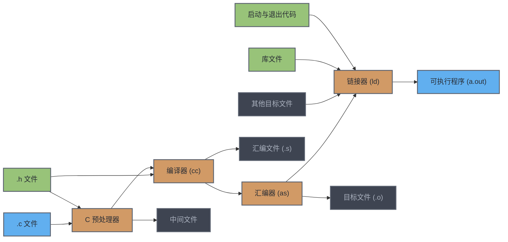

# Compilation Process
# 编译过程

当你编程时，你会一直使用**编译器**，所以从**高层**理解它做什么很有用。编译器的内部工作原理和细节相当复杂，需要深入理解计算机科学与工程的许多领域，因此我们不会深入这些。相反，我们只会涵盖与**日常编写程序**相关的部分。

![[Pasted image 20260918123353.png]]

上图展示了 `gcc` 编译代码过程的**高层概览**。在这张图中，浅蓝色盒子代表**你编写的代码**，而浅绿色盒子代表 **C 的内置部分**。橙色云朵表示该过程的**步骤**（每一步都是一个单独的程序，但 `gcc` 会为你调用这些程序），白色盒子表示 `gcc` 生成的**中间文件**，用于将信息从一个阶段传递到下一个阶段。右上角的深蓝色盒子代表**最终可执行文件**——你可以运行这个程序，让你的计算机执行程序告诉它做的任何事情。